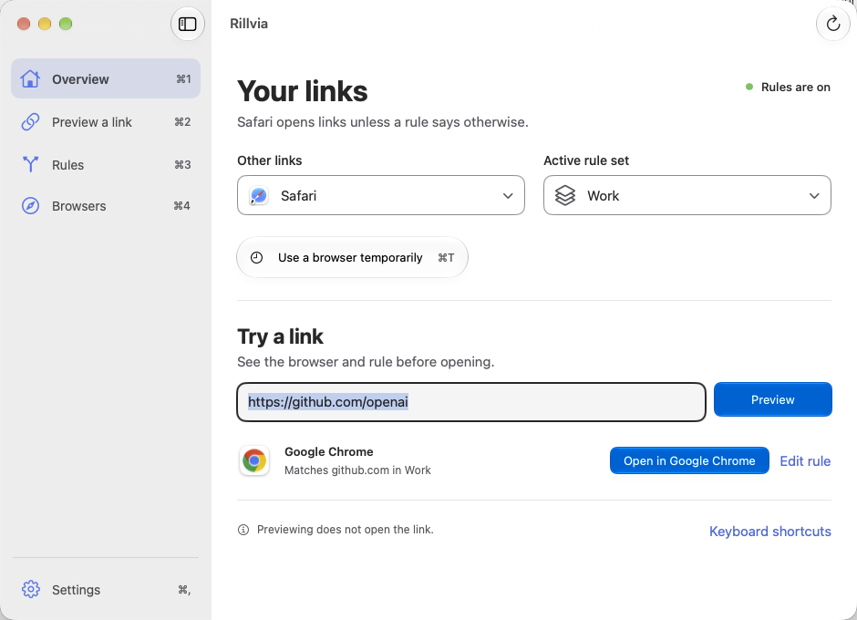
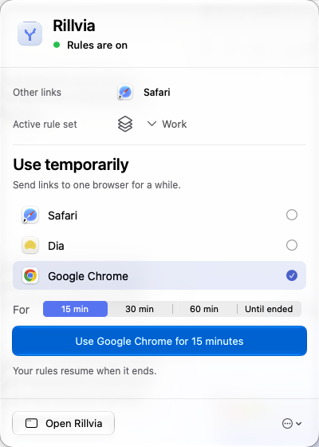
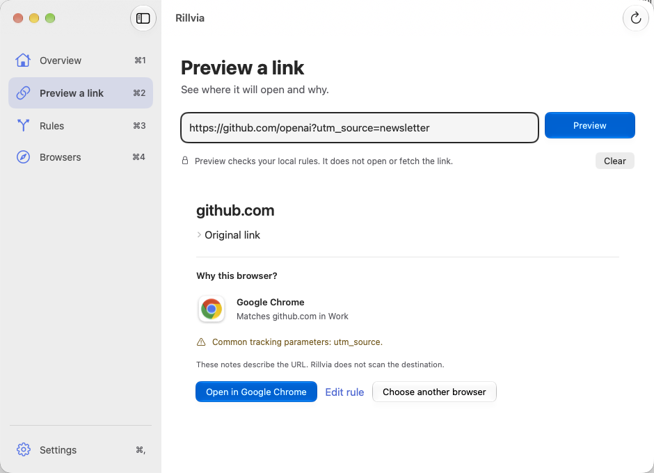
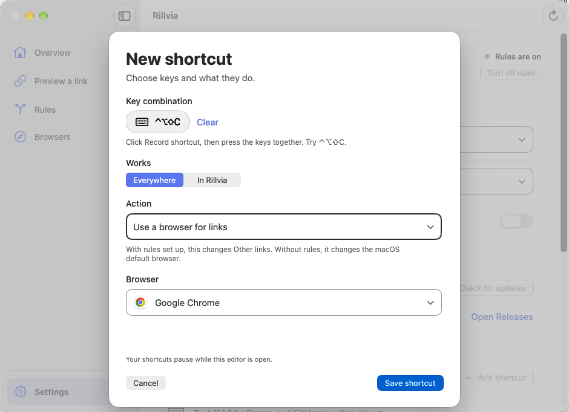
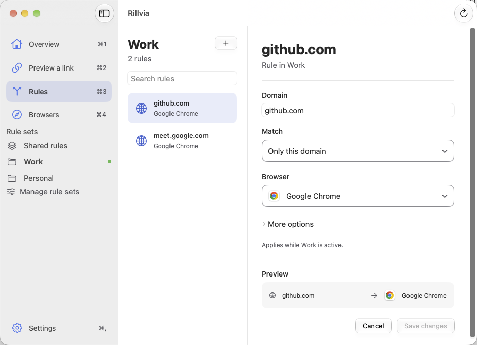
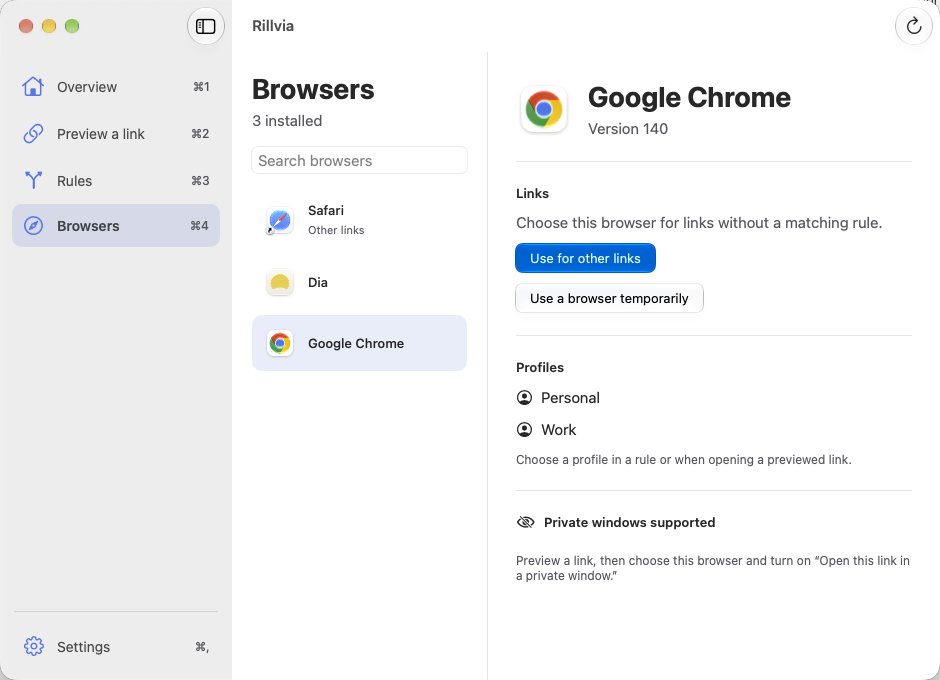
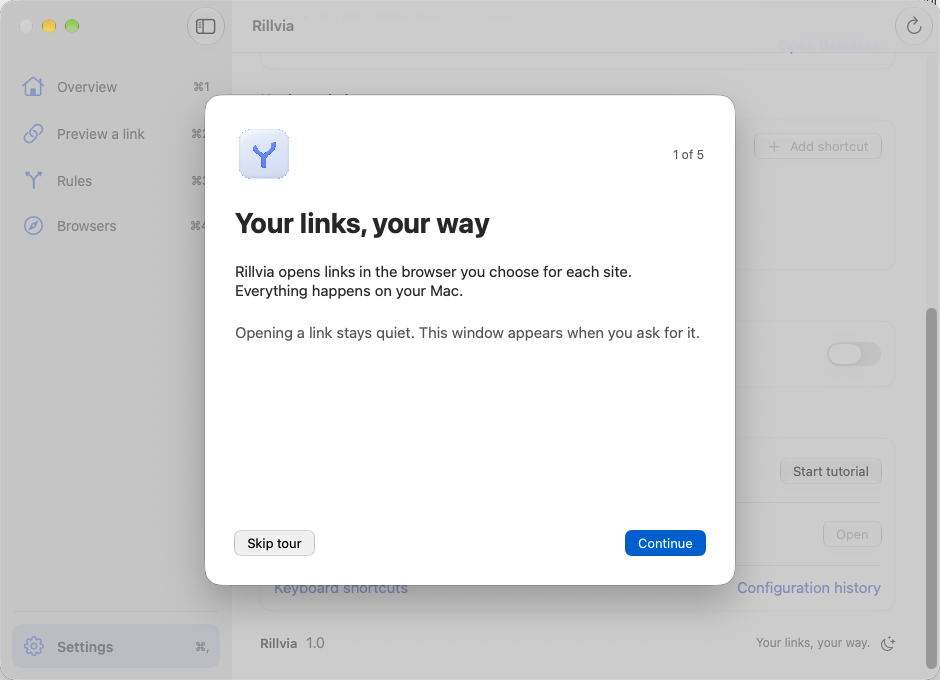

<h1 align="center">
  
  Rillvia
</h1>

<p align="center">
  <strong>Your links, your way.</strong><br>
  Work in Chrome. Read in Safari. Let each link find its browser.
</p>

<p align="center">
  <sub>A native macOS menu bar app · macOS 26+ · Apple silicon and Intel</sub>
</p>

<p align="center">
  <strong><a href="#get-rillvia">Get Rillvia</a></strong> &nbsp;·&nbsp;
  <a href="#a-small-menu-for-everyday-changes">See how it works</a> &nbsp;·&nbsp;
  <a href="#your-keys-your-actions">Keyboard shortcuts</a> &nbsp;·&nbsp;
  <a href="#development">Development</a>
</p>

<p align="center">
  <picture>
    <source media="(prefers-color-scheme: dark)" srcset="docs/images/overview-dark.png">
    
  </picture>
</p>

<p align="center">
  <sub>Native app captures with sample rules, taken 7 October 2026.<br>
  The latest solid controls are shown in the <a href="reviews/2026-10-08-quiet-controls/README.md">8 October design review</a>.</sub>
</p>

## Get Rillvia

**macOS 26 or later.** One universal app for Apple silicon and Intel Macs.

Development builds are available from GitHub Actions:

1. Open [Build Rillvia](https://github.com/masterdisk/Rillvia/actions/workflows/build.yml) and select a successful run on **main**.
2. Under **Artifacts**, download **Rillvia-universal-…** and unzip it.
3. Open the DMG and drag **Rillvia** into **Applications**.
4. Open Rillvia and follow the short setup tour. Choose a browser for **Other links**, then add your first rule.

Builds stay available for 14 days. See [builds and signing](docs/DISTRIBUTION.md) for distribution details; published versions will appear in [Releases](https://github.com/masterdisk/Rillvia/releases).

<details>
  <summary><strong>Build from source</strong></summary>

Use **Xcode with the macOS 26 SDK or newer**:

```sh
git clone https://github.com/masterdisk/Rillvia.git
cd Rillvia
open Rillvia.xcodeproj
```

Select the **Rillvia** scheme and run with **⌘R**. [Build, test, and run with sample data](docs/DEVELOPMENT.md).

</details>

## A small menu for everyday changes

Choose the browser for each site once. Rillvia uses those rules when you click a link.

- **Keep work and personal links separate.** Switch rule sets from the menu bar. Shared rules apply across sets.
- **Use one browser for a while.** Pick 15, 30, or 60 minutes, or until you stop. Your rules resume when the temporary choice ends.
- **Edit when you need to.** Open the workspace to change rules, review your browsers, or adjust settings.

<p align="center">
  <a href="docs/images/menu-bar.png"></a>
</p>

## Preview before you open

Paste a link to see its browser and the rule that matched. Preview reads your local rules without contacting the site or opening the link.

<p align="center">
  <a href="docs/images/preview.png"></a>
</p>

## Your keys, your actions

Switch browsers, change rule sets, or preview a copied link without reaching for the menu. Custom shortcuts can work **Everywhere**, even while another app is active, as long as Rillvia is running.

In **Settings → Keyboard shortcuts → Add shortcut**, record your keys, choose an action, and save. Choose **In Rillvia** for an app-only shortcut.

Examples you can configure:

| Keys | Action |
| --- | --- |
| <kbd>⌃⌥⇧C</kbd> | Use Google Chrome for links |
| <kbd>⌃⌥P</kbd> | Switch to your Personal rule set |

<p align="center">
  <a href="docs/images/shortcut-builder.png"></a>
</p>

<details>
  <summary><strong>Shortcut actions and built-in keys</strong></summary>

Custom actions include choosing a browser, starting or ending a temporary browser, switching or cycling rule sets, opening Rillvia, and previewing a copied web link. With rules configured, **Use a browser for links** changes the saved **Other links** choice. In direct mode, it changes the macOS default browser.

Saved shortcuts can be edited, disabled, or deleted with Undo. Custom shortcuts pause while the editor is open. The editor rejects ordinary typing, reserved app commands, and duplicate keys. If macOS cannot register a global shortcut, choose another combination.

These built-in keys work while Rillvia is active:

| Action | Keys |
| --- | --- |
| Overview / Preview / Rules / Browsers | <kbd>⌘1</kbd> / <kbd>⌘2</kbd> / <kbd>⌘3</kbd> / <kbd>⌘4</kbd> |
| Settings | <kbd>⌘,</kbd> |
| Focus link preview | <kbd>⌘L</kbd> |
| Choose browser for Other links | <kbd>⌘B</kbd> |
| Choose active rule set | <kbd>⇧⌘R</kbd> |
| Use a browser temporarily | <kbd>⌘T</kbd> |
| Search the current list | <kbd>⌘F</kbd> |
| New rule / Save rule | <kbd>⌘N</kbd> / <kbd>⌘S</kbd> |
| Preview focused input / Open current preview | <kbd>Return</kbd> / <kbd>⌘Return</kbd> |
| Undo a rule or rule-set change | <kbd>⌘Z</kbd> outside text fields |
| Keyboard shortcuts | <kbd>⌘/</kbd> |
| Diagnostics / Configuration history | <kbd>⌥⌘U</kbd> / <kbd>⌥⌘T</kbd> |

Inside text fields, **⌘Z** undoes typing. In pickers, arrows move, **Return** chooses, and **Esc** cancels.

Custom keyboard actions are separate from Apple Shortcuts automation, which has its own permission in Settings.

</details>

## Set it up, then make it yours

- **Save changes when you're ready.** Undo rule deletions and inspect earlier configurations without replacing your current rules.
- **Read it comfortably.** Choose light, dark, or system appearance and increase text to 200%.
- **Start with your Mac.** Turn on open at login in Settings. Replay the setup tour from **Settings → Help → Start tutorial**.
- **Update when it suits you.** Check in **Settings → Updates**. Download first, then choose **Install and restart** and confirm. Your rules and shortcuts carry over.

<details>
  <summary><strong>See the rule editor, browsers, and setup tour</strong></summary>

### Give each site a home

Choose a browser for a domain, keep the rule shared or in a set, and save when you're ready.

<p align="center">
  <a href="docs/images/rules.png"></a>
</p>

### Your installed browsers

Review available browsers and their accounts before choosing where links should open.

<p align="center">
  <a href="docs/images/browsers.png"></a>
</p>

### A short first-run tour

Review your browsers, add a rule, and try your first link preview. You can replay the tour later.

<p align="center">
  <a href="docs/images/tutorial.png"></a>
</p>

</details>

<details>
  <summary><strong>How Rillvia chooses a browser</strong></summary>

With rules on, Rillvia chooses in this order:

1. Your temporary browser, if one is active.
2. A matching rule in the active set.
3. A matching shared rule.
4. The browser chosen for **Other links**.

Turning rules off restores an external browser as the macOS handler. Rillvia also respects later default-browser changes made in macOS: rules pause, and **Turn on rules** resumes them. A link that still reaches Rillvia while rules are off or paused opens in the browser macOS uses.

Opening or copying a link preserves the original URL. Private-window choices apply to an individual open and are not silently saved as ordinary rules.

</details>

## Development

Built with **Swift and SwiftUI**. The project, scheme, and app are named **Rillvia**; the bundle ID is `com.rillvia.app`.

[Build and test](docs/DEVELOPMENT.md) &nbsp;·&nbsp;
[DMG builds, CI, and updates](docs/DISTRIBUTION.md) &nbsp;·&nbsp;
[Design checks](design-qa.md) &nbsp;·&nbsp;
[Screenshot sources](docs/images/README.md)

For updates from this private repository, use an existing GitHub CLI sign-in or **Open Releases**. [Update setup and installation checks](docs/DISTRIBUTION.md#updates-inside-rillvia).

---

<p align="center">
  <sub><strong>Rillvia</strong> joins <em>rill</em>, a small stream, with <em>via</em>, a route.</sub>
</p>
